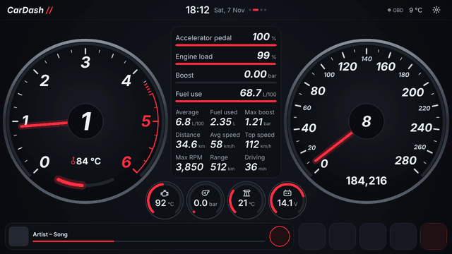
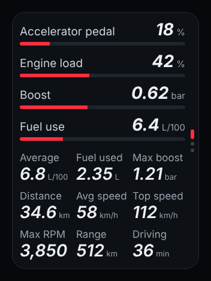
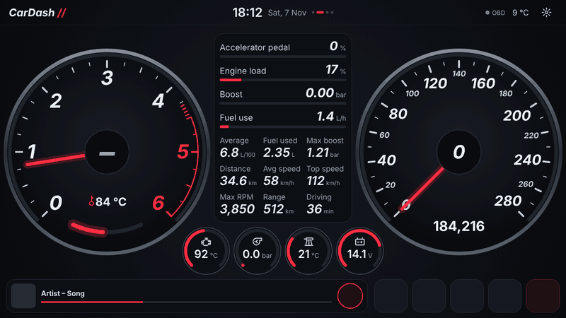
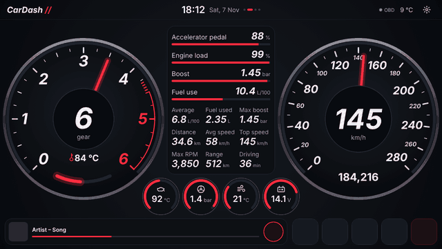
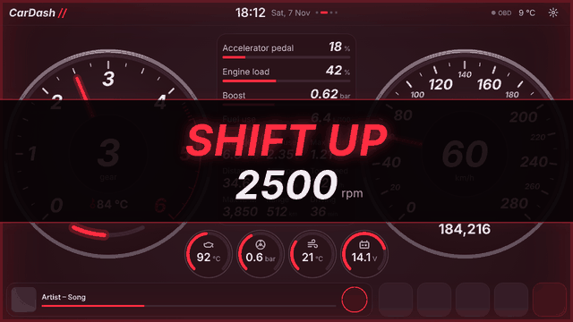
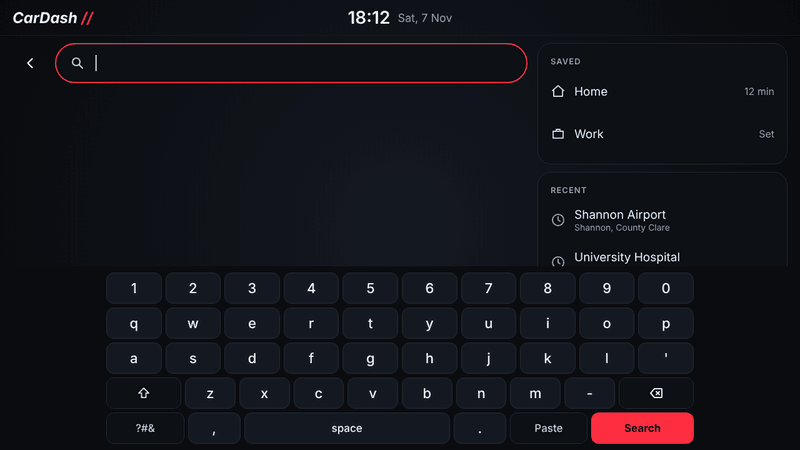

The page CarDash opens on, and the one the radio's Home button brings you back to.

## Across the top

- **Name**, top left: tap it to change it.
- **Time, date** and the page dots, side by side.
- **2 due** (only while something needs servicing): tap it for the [Service](Service) page.
- **OBD**: green while the car is answering.
- **Outside temperature**, when the car reports it.
- **The cog**: [Settings](Settings).

## The dials

- **RPM**, with the gear you're in big in the middle, and the coolant temperature as a number and a small arc low in the dial. The red zone is drawn like the TT's own: a thin red line along the ends of the ticks from 4,500, with close-set dashes just before it.
- **Change up / change down**: the gear lever icons in the empty corners at the top, between the big dials and the middle box: change down on the left, change up on the right. They only appear when it's time to change, set for the TT's 2.0 TDI: change up at 2,000 rpm (2,500 with the pedal past half way), so the next gear lands back where the engine makes its most torque, 1,750 to 2,500 rpm, and never into fewer than 1,500 rpm; change down under 1,300 rpm with your foot down, or under 1,100 rpm at all, where a diesel starts to judder and the dual-mass flywheel takes the strain. Turn them off in **Settings › Gear**.
- **The gear** is worked out, as the car doesn't send it: in each gear the engine turns a fixed number of rpm per km/h, and CarDash learns those figures as you drive. It shows once it has found every gear, or every gear but 1st or top (drive a few seconds in each); between gears, with the clutch down or coasting, it shows "–". The number of gears and **Learn the gears again** are in **Settings › Gear**.
- **Speed**, with the car's odometer under it once the [CAN box](Radios-CAN-box) gives it (until then, this drive's distance).

## The four small gauges

Under the middle box: oil temperature (the engine icon), boost (the turbo), intake air (the intake manifold) and battery voltage. Until the radio's CAN box gives the oil temperature, the first one shows engine load. A gauge turns brighter past its warning level: oil over 130 °C, intake air over 55 °C, battery under 11.8 V.

## The box in the middle

Swipe it up or down to change what it shows; the dots on its right edge show which view is on. **Hold it**, on any view, for [Where to?](Navigation#where-to).

1. **Car info**: this drive and the engine.
   - Bars for the accelerator pedal, engine load, boost and fuel use (L/100 km while moving, L/h standing still)
   - The average fuel use, fuel used, highest boost, distance, average and top speed, highest RPM, the car's range (or the air flow, if the car doesn't give range) and how long you've been driving
2. **Map**: the 3D map in the box, tilted and turning with the car, with the speed limit and traffic lights. On a route, the route and the next turn; without one, the street you're on, across the top, and **Where to?**.
3. **Directions**: on a route, the next turn filling the box (the arrow big in the middle, how far and what to do), the one after it, when you'll arrive, **End route** and the mute button. While Google Maps navigates, its next turn the same way. Otherwise, **Where to?**.
4. **Big map**: the same map in the RPM dial's place too, with six small gauges under it (RPM and coolant join the others), on a route or not. See [Big map](Navigation#big-map).

A figure the car doesn't report shows "–". See [Navigation](Navigation) for routes, the big map and saved map areas.

### A door, the boot or the bonnet open

Over whatever view is on: the TT from above, with what's open in the accent colour, and what's open in words ("Right door open").

## Along the bottom

- **Music**: what's playing, with previous, play/pause and next. Play starts your music app when nothing is playing. Hold the song title to choose which app that is.
- **Four app buttons**: tap to open. Long-press to choose the app or the icon.
- **All apps**: the [Apps](Apps) page.

## The speed warning

Over the speed set in **Settings › Speed warning** (150 km/h unless you change it), **SLOW THE FUCK DOWN** comes up across the whole screen with your speed under it, and the red above and below pulses twice a second. It goes once you're 5 km/h under the set speed again. The music and app buttons still work while it's showing.

## Shift up

Over the revs set in **Settings › Shift up** (2,500 rpm unless you change it), **SHIFT UP** comes up across the whole screen the same way, with the revs under it. It waits most of a second, so a gear change doesn't flash it, and goes once you're 300 rpm under. It doesn't come up in top gear: CarDash learns top gear the first time you drive steadily in it over 50 km/h for a few seconds, and remembers it. It doesn't come up below 5 km/h either, or while the speed warning is showing.

## Typing

Every box in CarDash (Where to?, the name, the Google key, the service items) uses CarDash's own keyboard, in the app's colours, instead of Android's. It runs right across the bottom of the screen, edge to edge, so the keys are as big as they can be. Numbers-only boxes get one row of big number keys. **Paste** puts in something you've copied, **?#&** has the symbols, and the red key does what the box is for (**Search**, **Done**).

## A service reminder

When an item on the [Service](Service) page gets close, a reminder pops up over Home. See [Service](Service#the-reminder).
