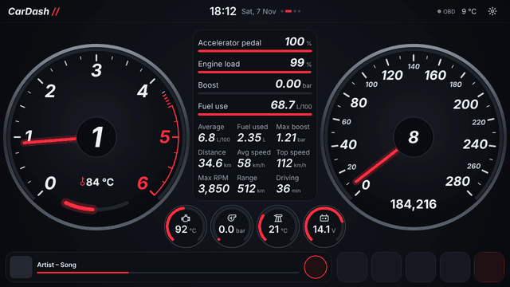

**CarDash** is a dashboard and home screen for Android car radios, with live engine data from a USB ELM327 OBD dongle. It's made for a 1280×720 UIS7862 radio in an Audi TT and laid out for that screen, but scales to any radio.

## The pages

Swipe left and right between four pages. The dots under the clock show where you are; tap a dot to jump to that page. The radio's Home button always brings you back to Home.

| Page | What's on it |
|---|---|
| [Apps](Apps) | Everything installed on the radio |
| [Home](Home-page) | RPM and speed dials, four small gauges, the middle box (this drive, directions or the 3D map), music and four app buttons |
| [Gauges](Gauges) | Every reading the car gives, and the engine's fault codes |
| [Service](Service) | Oil, filters, brake fluid and anything you add, counted down from the car's odometer |

[Settings](Settings) open from the gear, top right.

## Start here

- [Setting up](Setting-up): installing CarDash and the OBD dongle
- [Service](Service): setting up the maintenance reminders
- [Navigation](Navigation): the 3D map, Where to?, spoken directions and saved map areas
- [Radio's CAN box](Radios-CAN-box): oil temperature, odometer and the rest from the radio
- [Fuel use](Fuel-use): matching CarDash's fuel figures to the car's
- [Troubleshooting](Troubleshooting)
