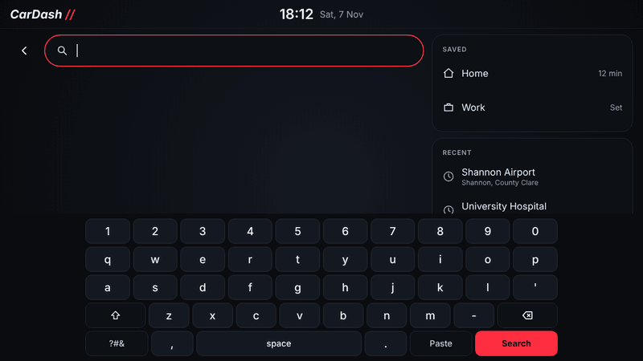
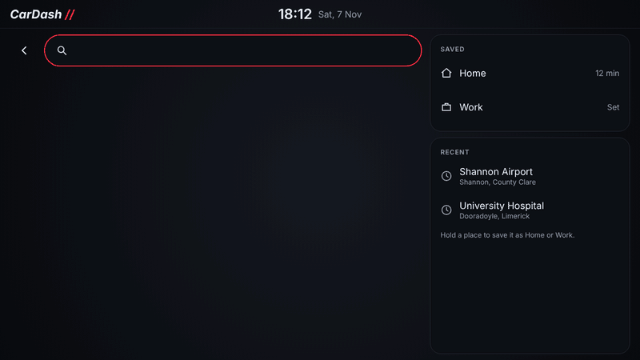
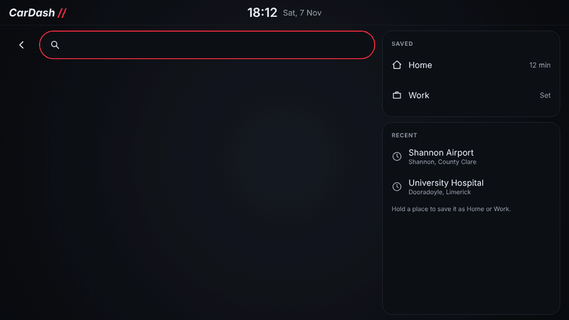
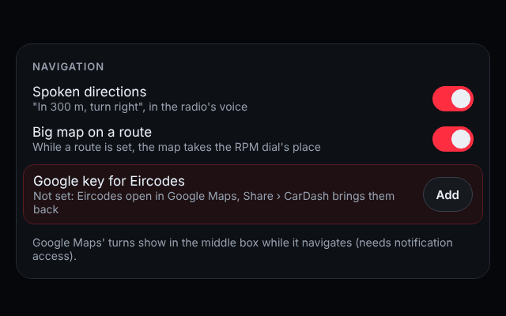
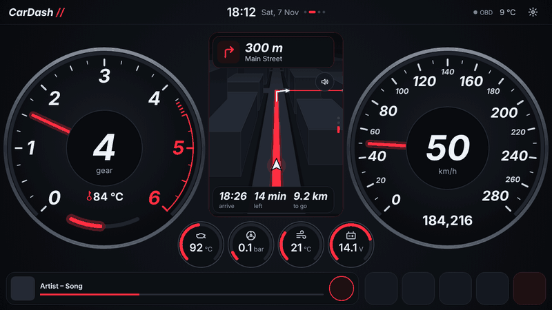
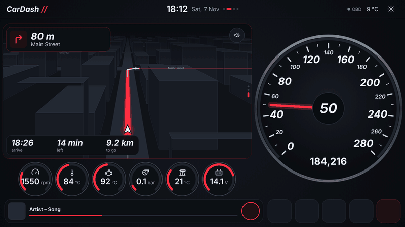
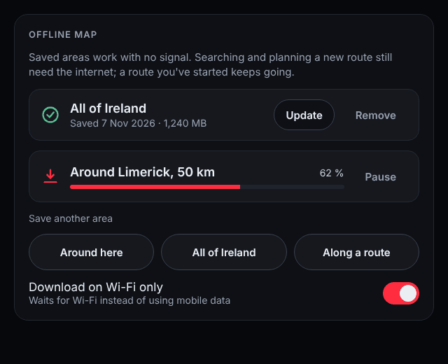

CarDash has its own navigation: a 3D map, place search, routes, and the directions read out. It can also show Google Maps' next turn while Google Maps navigates.

## Where to?

Hold the middle box on Home, on any of its views, or tap **Where to?** on the map.

- Type a place, an address or a town. Results come up as you type, nearest first, with how far away each is.
- Tap one: the box at the bottom shows how long it takes, how far it is and when you'd arrive. **Go** sets off.
- **Saved**: Home and Work. **Hold** any place (a result or a recent one) to save it as Home or Work.
- **Recent**: the last places you drove to. Hold one to remove it.

### Eircodes and places the search doesn't know

CarDash's own search (the free OpenStreetMap search) doesn't know Eircodes. There are two ways to get there with CarDash:

- **Share from Google Maps (no setup).** Type the Eircode, or anything the search can't find, and tap **Find it in Google Maps**. Google Maps opens on the place: tap **Share**, then **CarDash**. CarDash comes back, finds where the place is and starts the route straight away. This works from anywhere in Google Maps (a place, a dropped pin, a directions screen), and "Open in maps" from other apps (a location in a message, an address in a contact) can open CarDash too.
- **Your own Google key (Eircodes found right in CarDash).** Add a key in **Settings › Navigation › Google key for Eircodes** and Eircodes come up in CarDash's search like any other place. See [Getting a Google key](#getting-a-google-key) below.

Or tap **Or let Google Maps drive**: Google Maps opens and starts the route itself. Come back to CarDash any time: the middle box shows Google's next turn.

### Getting a Google key

Free for anything you'll use it for: Google gives 10,000 address lookups a month free, and CarDash uses one per Eircode you look up. Google asks for a card to set up billing even so.

1. Go to [console.cloud.google.com](https://console.cloud.google.com) and sign in with your Google account.
2. Make a project (call it CarDash) and set up billing for it when asked.
3. Open **Google Maps Platform › Keys & Credentials** and click **Create credentials › API key**.
4. Under API restrictions, pick **Geocoding API** only, and save. (If Google says the Geocoding API isn't turned on, open the **API Library**, find **Geocoding API** and click **Enable**.)
5. Copy the key (it starts with AIza) and paste it into **Settings › Navigation › Google key for Eircodes** in CarDash. CarDash tries it once before keeping it and shows Google's reason if it doesn't work.

To be sure it never costs anything, set the Geocoding API's daily limit to a few hundred under **APIs & Services › Geocoding API › Quotas**.

## On a route

The middle box switches to the map, tilted and turning with the car, the route in the accent colour and an arrow at the next turn. On top: the next turn and how far. Underneath: when you'll arrive, the time left and the distance to go.

Swipe the middle box down to **Directions** for the next turn big, the one after it, and **End route**.

- **Spoken directions**: "In 300 metres, turn right onto Main Street", then again at the turn, in the radio's voice. The speaker button mutes them; tap it again for sound. Turn them off altogether in **Settings › Navigation**.
- **Off the route**: CarDash plans a new one from where you are.
- **There**: it says so and ends the route a few seconds later.

### Big map

With **Settings › Navigation › Big map on a route** on, the map takes the RPM dial's place while you're on a route and the map is showing. Under it, six small gauges instead of four: RPM and coolant join oil, boost, intake air and battery. Swipe the middle box to another view, or end the route, and Home goes back to normal.

## Speed limits and traffic lights

On the map, a round **speed-limit sign** shows the limit on the road you're on; it turns red inside once you're more than 2 km/h over. **Traffic lights** stand on the map where they are. Both come from OpenStreetMap (the Overpass API), fetched for the area around you as you drive. In Ireland the limits are well mapped on main roads and in towns; where a road has no limit in OpenStreetMap, the sign just doesn't show.

The roads are drawn lighter than the dark map, with white edges, so they stand out at a glance, and the buildings stand on the streets in 3D.

## Google Maps

Navigating in the Google Maps app instead? Its next turn fills the middle box's **Directions** view (Google's arrow big in the middle, the distance to it and what to do), with when you'll arrive, the time left and the distance to go under it, and a button back to Google Maps. CarDash needs **Notification access** for this (Settings › Permissions).

## Offline map

**Settings › Offline map** keeps map areas on the radio for driving without signal:

- **Around here**: everything within 50 km (needs a GPS position).
- **All of Ireland**: the whole island, down to street level. A big download.
- **Along a route**: the roads along the route you're on.

**Quicker for a big area**: the radio fetches every map tile itself, which is slow over a phone's hotspot. Download the area with CarDash on your phone instead, tap **Copy saved areas to a file**, put that file on a USB stick, and on the radio tap **Load saved areas** and pick it. Both need the same CarDash version. An area that didn't finish carries on where it stopped the next time CarDash starts, unless you paused it: what was downloaded is kept. **Download on Wi-Fi only** waits for Wi-Fi instead of using the radio's own mobile data; a phone's hotspot counts as Wi-Fi. If a download says the radio doesn't let CarDash use the internet, allow CarDash's network access in the radio's own settings (Apps › CarDash) and turn off any data saver for it. If it says Android didn't give CarDash its internet permission, uninstall CarDash and install it again: a radio updated from CarDash 1.0.1–1.0.8, which didn't ask for it, may not get it back. A saved area shows its date and size; **Update** fetches it again for map changes (only the tiles that changed). An area saved more than 60 days ago shows as out of date and updates by itself the next time the radio is on Wi-Fi (a phone's hotspot counts, the radio's own mobile data doesn't); with more than one, **Update all** does them all, **Remove** deletes it. A download can be paused and resumed.

Searching and planning a new route still need the internet; a route you've already started keeps going without it.

## What it needs

- **Location**: CarDash asks the first time the map or Where to? opens. Allow it in **Settings › Permissions** if you said no.
- **Internet** for the map (unless the area is saved), the search, new routes, and speed limits and traffic lights.

## Where the data comes from

- The map: [OpenFreeMap](https://openfreemap.org), from OpenStreetMap
- The search: [Photon](https://photon.komoot.io) by Komoot, from OpenStreetMap
- The routes: [OSRM](https://project-osrm.org) on the OpenStreetMap community's server
- Speed limits and traffic lights: the [Overpass API](https://overpass-api.de)

All free and without accounts. Map data © OpenStreetMap contributors.
