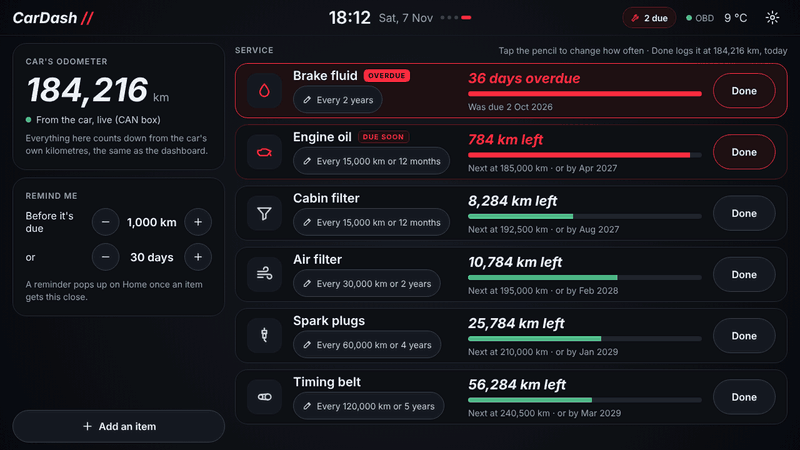
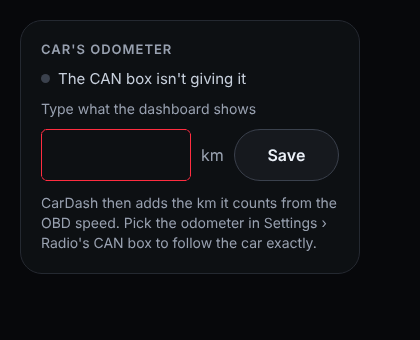
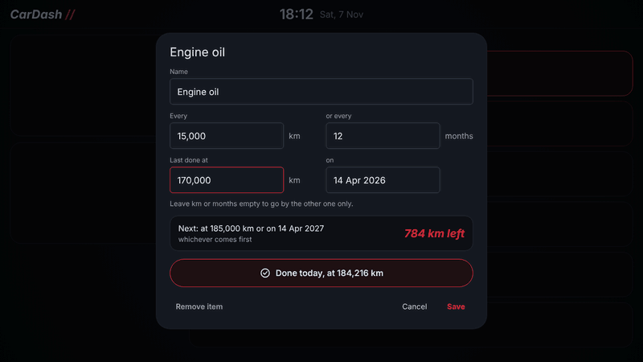
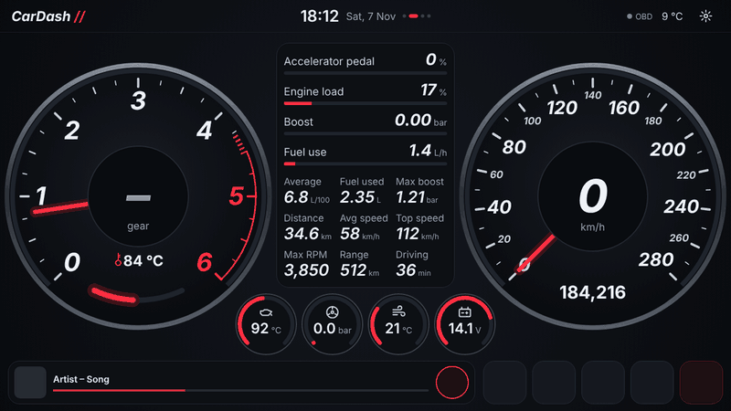

The **Service** page keeps track of the car's maintenance: oil, filters, brake fluid and anything you add. Each item counts down from the **car's own odometer**, by kilometres, months, or both, whichever comes first. It's the fourth page: swipe left from Home past Gauges.

The page is for looking: the odometer, how many items are due, and every item with how far off it is. Everything is set up in **Settings › Service**: tap **Change**, or any item, to go there.

## The car's odometer

Everything counts down from the kilometres the car's dashboard shows.

- **From the CAN box**: on radios with a CAN box (like the one in the TT), CarDash reads the odometer straight from the car. The card says *From the car, live (CAN box)*. If your radio's CAN box puts the odometer somewhere else, pick it in [Settings › Radio's CAN box](Radios-CAN-box).
- **Without one**: in **Settings › Service**, type in what the dashboard shows and tap **Save**. CarDash then adds the distance it works out from the OBD speed as you drive. That drifts a little over time, so type the dashboard reading in again now and then.

## The items

A new install starts with:

| Item | Every |
|---|---|
| Engine oil | 15,000 km or 12 months |
| Air filter | 30,000 km or 2 years |
| Cabin filter | 15,000 km or 12 months |
| Spark plugs (a fuel filter on a diesel) | 60,000 km or 4 years |
| Brake fluid | 2 years |

These are only starting points: set them to what your car's service book says.

Each item shows:

- **How far off it is**: *8,284 km left*, *5 months left* or *36 days overdue*, whichever of km or time comes first
- **A health bar** of squares, like in a game: all lit just after it's done, going out one by one down to none when it's due. Green, amber once under half is left, red when it's due soon; overdue, the empty squares are red
- **When it's next due**: *Next at 192,500 km · or by Aug 2027*

The most urgent items are at the top. Items not set up yet say *Not set yet* and sit at the bottom.

## Setting an item up

In **Settings › Service**, every item has its interval (with a pencil), **Done** and **×**. Tap the name or the pencil to open it. You can change:

- **Name**
- **Every … km** and **or every … months**. Leave one empty to go by the other only (brake fluid goes by time only, for example).
- **Last done at … km** and **on** (tap for a calendar)

The box underneath shows when it's next due and how far off that is, as you type. **Save** keeps the changes.

## Done

Tap **Done** on an item in **Settings › Service** when you've had it done. It opens with the odometer now and today's date: **Save** logs it, and the countdown starts again. If it was done at another km or on another day (you're logging it late), change the km or tap the day for a calendar before you save. **Done today** inside an item logs it straight away at the odometer now.

## Your own items

**Add an item** in **Settings › Service** opens a list of parts that need changing now and then, each with its icon and the usual interval to start from:

| Part | Starts at |
|---|---|
| Timing belt, Auxiliary belt | 120,000 km or 5 years |
| Gearbox oil | 120,000 km |
| Haldex oil and filter (quattro) | 60,000 km or 3 years |
| Coolant | 5 years |
| Brake pads | 40,000 km |
| Brake discs | 80,000 km |
| Tyres | 40,000 km or 5 years |
| Wiper blades | 12 months |
| Battery | 5 years |
| Glow plugs (diesel) | 100,000 km |
| Air con service | 2 years |
| NCT | 2 years |

Pick one, fill in when it was last done (and change the interval to what your car's book says), and **Save**. **Something else** makes your own: give it a name, pick an icon, how often, and when it was last done. Any item's icon can be changed when you open it.

To get rid of any item (spark plugs on a diesel, say), tap its **×**, then **Remove?** to be sure. Removed one of the suggested items by mistake? **Put back the suggested items** brings back any that are missing. The suggestions follow the engine set in **Settings › Car › Fuel use**: a fuel filter on a diesel, spark plugs on a petrol.

## The reminder

When an item is within **1,000 km** or **30 days** of being due (or is overdue), a reminder pops up on Home listing what needs doing:

- **Done** next to an item logs it as done now.
- **Remind me later** hides the reminder until the next drive.
- **Open Service** goes to the Service page.

While anything is due, the header also shows **2 due** (or however many), which opens the Service page.

To change how early the reminder comes, use **Remind me** in **Settings › Service**: 250 to 5,000 km, and 5 to 90 days.

A new drive starts when CarDash starts, or when the car answers again after more than three minutes without it.
