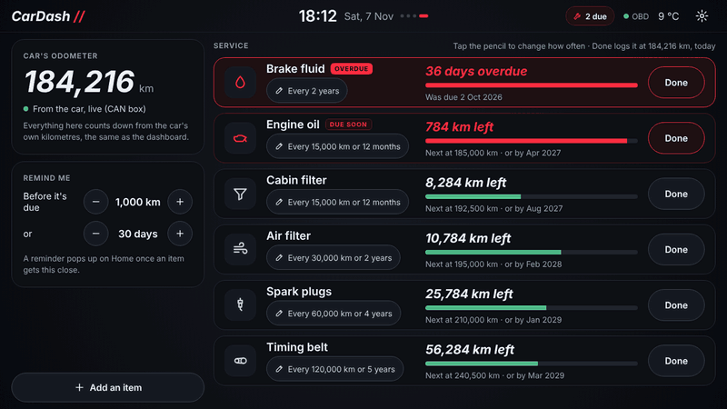
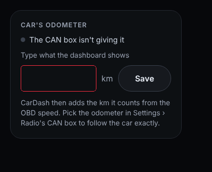
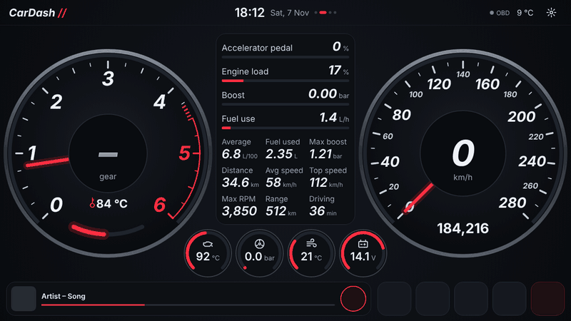

The **Service** page keeps track of the car's maintenance: oil, filters, brake fluid and anything you add. Each item counts down from the **car's own odometer**, by kilometres, months, or both, whichever comes first. It's the fourth page: swipe left from Home past Gauges.

The page is for looking: the odometer, how many items are due, and every item with how far off it is. The items are set up in CarTracker and read from LubeLogger: see [LubeLogger](#lubelogger) below.

## The car's odometer

Everything counts down from the kilometres the car's dashboard shows.

- **From the CAN box**: on radios with a CAN box (like the one in the TT), CarDash reads the odometer straight from the car. The card says *From the car, live (CAN box)*. If your radio's CAN box puts the odometer somewhere else, pick it in [Settings › Radio's CAN box](Radios-CAN-box).
- **Without one**: in **Settings › Service**, type in what the dashboard shows and tap **Save**. CarDash then adds the distance it works out from the OBD speed as you drive. That drifts a little over time, so type the dashboard reading in again now and then.

## The items

The items are the ones you set up in CarTracker (engine oil, filters, timing belt and so on), read from LubeLogger.

Each item shows:

- **How far off it is**: *8,284 km left*, *5 months left* or *36 days overdue*, whichever of km or time comes first
- **A health bar** of squares, like in a game: all lit just after it's done, going out one by one down to none when it's due. Green, amber once under half is left, red when it's due soon; overdue, the empty squares are red
- **When it's next due**: *Next at 192,500 km · or by Aug 2027*

The most urgent items are at the top. Items not set up yet say *Not set yet* and sit at the bottom.

## The reminder

When an item is within **1,000 km** or **30 days** of being due (or is overdue), a reminder pops up on Home listing what needs doing:

- **Remind me later** hides the reminder until the next drive.
- **Open Service** goes to the Service page.

While anything is due, the header also shows **2 due** (or however many), which opens the Service page.

To change how early the reminder comes, use **Remind me** in **Settings › Service**: 250 to 5,000 km, and 5 to 90 days.

A new drive starts when CarDash starts, or when the car answers again after more than three minutes without it.

## LubeLogger

The service items are set up in **CarTracker** on your phone and kept in [LubeLogger](https://lubelogger.com); CarDash shows them here, read only, counting down from the car's own kilometres.

In **Settings › Service**, tap **Connect LubeLogger**, give its address and an API key from LubeLogger's settings (the **Editor** role if CarDash should send the odometer, otherwise Viewer is enough), then pick which of its vehicles this car is.

- **The items**: each one, with its interval and when it was last done, as CarTracker keeps it. Work logged since (a service, repair or upgrade record with the item's name in its description) counts as done, so the bar fills straight away. CarDash reads them when it starts, at the start of each drive and every six hours, and keeps the last copy for when the radio is offline.
- **Send the odometer** (optional): once a day, as the first drive starts, CarDash adds an odometer record with the dashboard's kilometres, read from the CAN box while the car is still parked. It needs the odometer from the CAN box ([Radio's CAN box](Radios-CAN-box)). The record's note has the exact time, which [CarTracker](https://github.com/bornaradusin/CarTracker/wiki/Service-and-costs) uses to set the tracker's kilometres to match. If the radio is offline, readings wait and go when it's back online.

Adding, changing and logging items is done in CarTracker: the Service page here has no Done any more, and the reminder that pops up while something is due only offers **Remind me later**.
