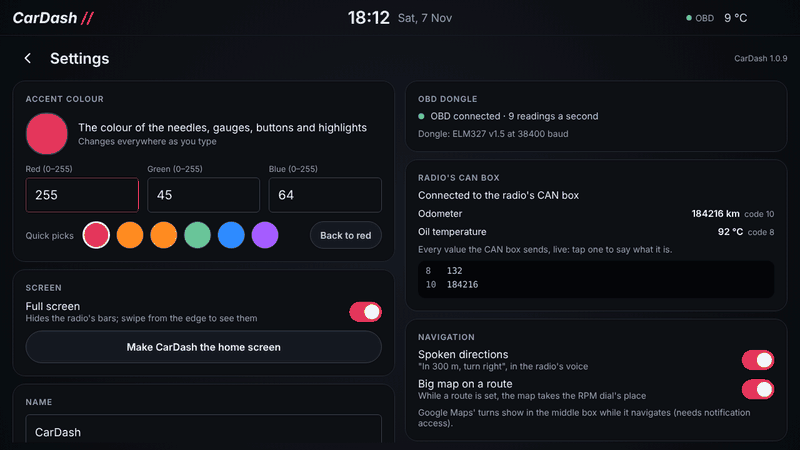

Open Settings from the gear, top right. The back arrow, or the radio's Home button, closes them.

| Card | What's there |
|---|---|
| Accent colour | The colour of the needles, gauges, buttons and highlights. Type its **red, green and blue** (0–255 each) and it changes everywhere as you type, or tap a quick pick. **Back to red** puts it back |
| Name | The name top left on Home (tapping it there changes it too) |
| Music | The app Play starts when nothing is playing |
| Screen | **Full screen** hides the radio's own bars (swipe from the edge to see them). **Make CarDash the home screen** |
| Speed warning | **Warn me when I'm too fast**, and the speed: 50 to 250 km/h in steps of 10 (150 to start with). See [Home](Home-page#the-speed-warning) |
| Shift up | **Tell me to change up**, and the revs: 1,500 to 6,000 rpm in steps of 100 (2,500 to start with). Not in top gear. See [Home](Home-page#shift-up) |
| Navigation | **Spoken directions** on or off, **Big map on a route**, and **Google key for Eircodes**: see [Navigation](Navigation) |
| Permissions | **Notification access**, for Google Maps' next turn and the music controls. **Location**, for the map and directions |
| OBD dongle | The connection, the dongle's name and speed, the car's protocol and a log of what was sent and received. **Ask for USB access again** if you said no |
| Radio's CAN box | Every value the CAN box sends, and which is the oil temperature, odometer and so on: see [Radio's CAN box](Radios-CAN-box) |
| Fuel use | Diesel engine, and matching the fuel figures to the car's: see [Fuel use](Fuel-use) |
| Offline map | Map areas saved for driving without signal: see [Navigation](Navigation#offline-map) |
